<!--
  Styles live in workshop.scss. Useful classes:
    [word]{.git} / [word]{.gh}     orange Git / blue GitHub words
    [word]{.desk}                  purple GitHub Desktop words
    [word]{.good} / [word]{.bad}   green / red words
    [phrase]{.hl}                  highlighter-pen effect
    ::: {.card} ... :::            soft box (add .git, .gh, .desk, .good or .bad for the top colour)
    ::: {.grid2} / {.grid3}        put cards side by side
    ::: {.keybox} ... :::          key message box

  Screenshots sit inside the bullet they belong to, so they appear on the
  same click. Each one covers the previous one in the same spot on the right.
-->

## Today

::: {.grid3}
::: {.card}
[Why]{.card-title}
Why use Git and GitHub, for the lab and for you?
:::

::: {.card}
[Key ideas]{.card-title}
The words you'll hear
:::

::: {.card}
[Set up]{.card-title}
GitHub Desktop
:::

::: {.card .git}
[The workflow]{.card-title}
Fork, commit, push, pull request
:::

::: {.card .gh}
[Hands-on]{.card-title}
Fork a real project and send a pull request
:::
:::

. . .

::: {.keybox}
No prior experience needed. Ask questions at any time!
:::

# Why bother? {background-color="#191970"}

## The lab's view: one repo per project

All our projects live on [**github.com/RealityBending**](https://github.com/RealityBending)

- Every project has **its own repository**
- All repos are **organised the same way**, so anyone can find anything
- Everything in one place: **code, data, documents and paper**
- A full history of every change, and easy to **share** when we publish

## How our repos are organised

::: {.grid3}
::: {.card .gh .fragment}
[`analysis/`]{.card-title}
The analysis scripts
:::

::: {.card .gh .fragment}
[`data/`]{.card-title}
The **anonymised** data, ready to analyse
:::

::: {.card .gh .fragment}
[`documents/`]{.card-title}
The approved ethics (PDF) and ethics documents, e.g., the questionnaires we use as PDFs
:::

::: {.card .gh .fragment}
[`experiment/`]{.card-title}
The scripts for our experiments, created with [jsPsych](https://www.jspsych.org), and our **stimuli**
:::

::: {.card .git .fragment}
[`paper/`]{.card-title}
Eventually: the manuscript (written in R), with a folder for each journal we submit to
:::
:::

::: {.callout-important .fragment}
## Where is the raw data?
The **raw** data stays on **Box**. A **pre-processing script** anonymises it and saves the anonymised version in the repo's `data/` folder.
:::

## Your view: sound familiar?

:::: {.columns}

::: {.column width="50%"}
::: {.card .bad}
[Without Git]{.card-title}

- `analysis.R`
- `analysis_v2.R`
- `analysis_v2_final.R`
- `analysis_v2_final_REALLY.R`
- `analysis_USE_THIS_ONE.R`
:::
:::

::: {.column width="50%"}
::: {.card .good}
[With Git]{.card-title}

- One file: `analysis.R`
- Every version saved, with a note on **what** changed and **why**
- Go back to any point in time
:::
:::

::::

## What you get

::: {.grid3}
::: {.card .fragment}
[A backup]{.card-title}
Your work, safe in the cloud
:::

::: {.card .fragment}
[A time machine]{.card-title}
Undo mistakes, see old versions
:::

::: {.card .fragment}
[Teamwork]{.card-title}
No more overwriting each other
:::

::: {.card .fragment}
[Open science]{.card-title}
Share code and data with one link
:::

::: {.card .fragment}
[Free websites]{.card-title}
With GitHub Pages (e.g., [The REBEL lab](https://realitybendinglab.com/))
:::
:::

# Key ideas {background-color="#191970"}

## Git, GitHub Desktop and GitHub

::: {.grid3}
::: {.card .git}
[[Git]{.git}]{.card-title}

- A **program**
- Installed on **your computer**
- Tracks every change to your files (*version control*)
:::

::: {.card .desk}
[[GitHub Desktop]{.desk}]{.card-title}

- An **app** on **your computer**
- Buttons instead of typing Git commands
- Connects your computer to GitHub
:::

::: {.card .gh}
[[GitHub]{.gh}]{.card-title}

- A **website**
- Stores your projects **online** (in the cloud)
- For sharing and collaborating
:::
:::

## An analogy with R

| | The engine | The friendly interface |
|---|---|---|
| **Analysing data** | R | RStudio |
| **Version control** | [Git]{.git} | [GitHub Desktop]{.gh} |
<br><br>

- The **engine** does the work; the **interface** gives you buttons instead of commands
- GitHub Desktop comes with Git built in, so you only install **one** thing
- [GitHub]{.gh} (the website) is where your projects live online

## Vocabulary

| Term | What it means | Where |
|------|---------------|-------|
| **Repository** (repo) | A project folder tracked by Git | Both |
| **Fork** | Your own copy of someone else's repo | github.com |
| **Clone** | Copy a repo from GitHub to your computer | GitHub Desktop |
| **Commit** | A saved snapshot of your files | GitHub Desktop |
| **Push** | Send your commits to GitHub | GitHub Desktop |
| **Pull** | Get new commits from GitHub | GitHub Desktop |
| **Pull request** (PR) | Ask the owner to add your changes | github.com |

# Getting set up {background-color="#191970"}

## Setup

::: {.nonincremental}
1. Create a free account at [github.com](https://github.com)
2. Install [GitHub Desktop](https://desktop.github.com)
3. Open it and **sign in** with your GitHub account
4. Check your name and email:
   - Windows: **File ➜ Options ➜ Git**
   - Mac: **GitHub Desktop ➜ Settings ➜ Git**
:::

## A quick tour of GitHub Desktop

:::: {.columns}

::: {.column width="30%"}
::: {.nonincremental}
[1. **Left side**: all the repos]{.fragment fragment-index=1}

[2. **Top bar**: repository, branch, Push / Pull]{.fragment fragment-index=3}

[3. **Changes**: what you've edited]{.fragment fragment-index=5}

[4. **Bottom left**: write a message, commit]{.fragment fragment-index=6}

[5. **History**: all past commits]{.fragment fragment-index=7}
:::
:::

::: {.column width="70%"}
::: {.r-stack}
::: {.fragment .fade-out fragment-index=4}
{.fragment fragment-index=2}
:::

::: {.fragment .fade-out fragment-index=8}
{.fragment fragment-index=4}
:::

{.fragment fragment-index=8}
:::
:::

::::

# The workflow {background-color="#191970"}

## Clone, fork or branch?

There are different ways to work with a repository:

::: {.grid3}
::: {.card .fragment}
[Clone]{.card-title}
A copy **from GitHub to your computer**
:::

::: {.card .gh .fragment}
[Fork]{.card-title}
A copy **on GitHub**, under **your** account
:::

::: {.card .git .fragment}
[Branch]{.card-title}
A parallel line of work **inside the same repo**
:::
:::

## The big picture

```{mermaid}
%%| fig-width: 10
flowchart LR
  A[(Original repo)] -- ① Fork --> B[(Your fork)]
  B -- ② Clone --> C[Your computer]
  C -- ③ Commit &amp; ④ Push --> B
  B -- ⑤ Pull request --> A
```

. . .

::: {.keybox}
Commit [little and often]{.hl}. Push at least at the **end of every day**.
:::

## 1. Fork the repo

A **fork** is a copy of a repository under **your** account. Use it when you **can't** edit the original.

:::: {.columns}

::: {.column width="30%"}
::: {.nonincremental}
[1. On github.com, open the original repo and click **Fork** (top right)]{.fragment fragment-index=1}

[2. Keep the name and click **Create fork**]{.fragment fragment-index=3}
:::
:::

::: {.column width="70%"}
::: {.r-stack}
::: {.fragment .fade-out fragment-index=4}
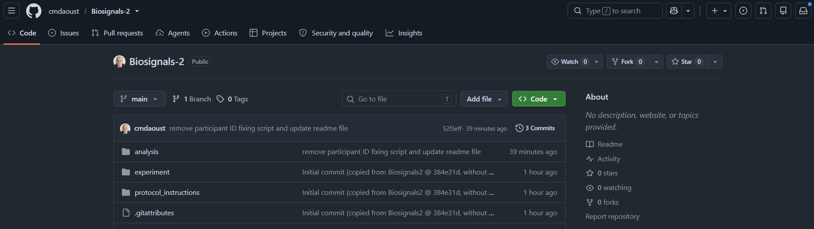{.fragment fragment-index=2}
:::

::: {.fragment .fade-out fragment-index=5}
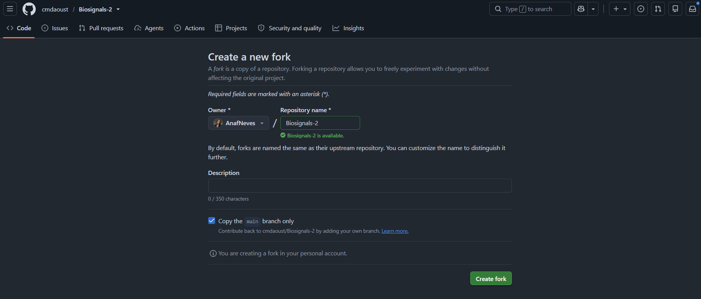{.fragment fragment-index=4}
:::

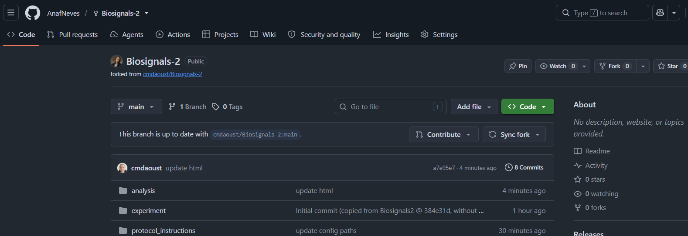{.fragment fragment-index=5}
:::
:::

::::

::: {.keybox}
You now have [your own copy]{.hl}: whatever you do there, the original stays untouched.
:::

## 2. Clone your fork

In GitHub Desktop:

:::: {.columns}

::: {.column width="40%"}
::: {.nonincremental}
[1. **File ➜ Clone repository**]{.fragment fragment-index=1}

[2. Choose the **URL** tab and paste **your fork's** URL (it has *your* username)]{.fragment fragment-index=3}

[3. Choose a **Local path** (not in OneDrive!) and click **Clone**]{.fragment fragment-index=5}

[4. GitHub Desktop asks how you'll use the fork: choose **To contribute to the parent project**]{.fragment fragment-index=7}
:::
:::

::: {.column width="60%"}
::: {.r-stack}
::: {.fragment .fade-out fragment-index=4}
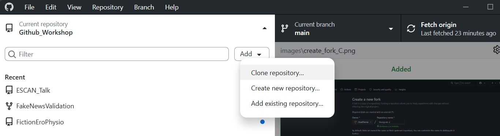{.fragment fragment-index=2}
:::

::: {.fragment .fade-out fragment-index=8}
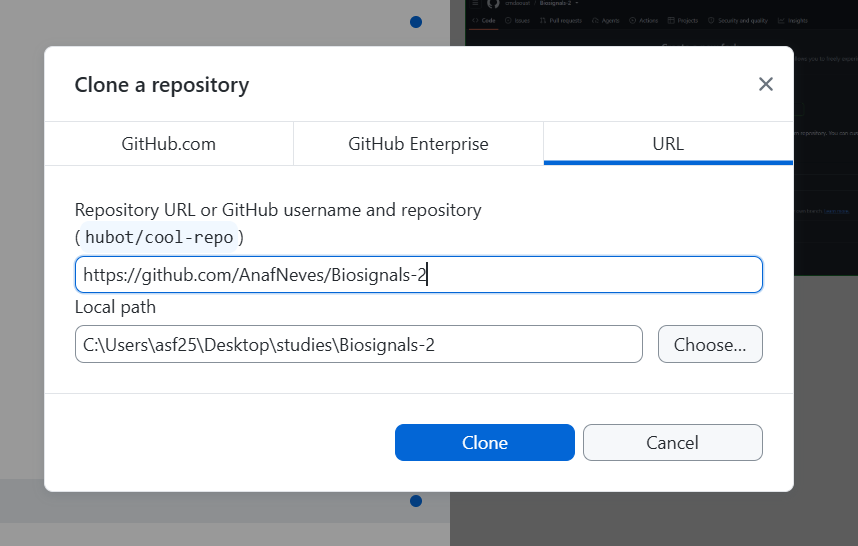{.fragment fragment-index=4}
:::

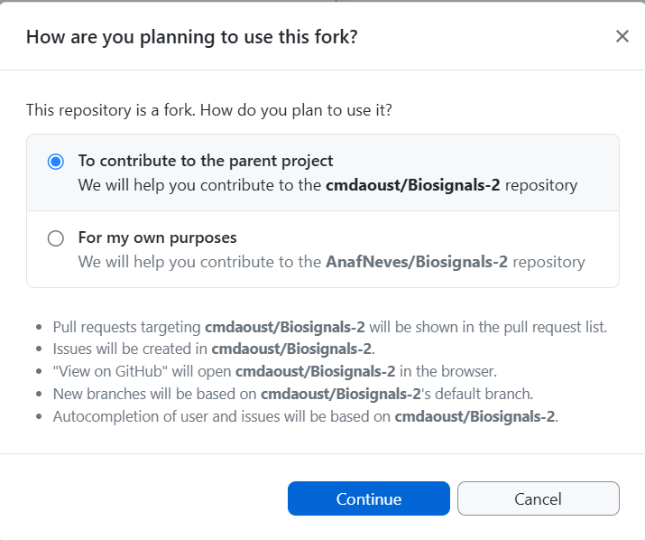{.fragment fragment-index=8 width="62%"}
:::
:::

::::

::: {.callout-note .fragment fragment-index=9}
## Which option?
**To contribute to the parent project:** pull requests, issues and new branches point to the **original** repo, so your changes can go back to it.
<br>**For my own purposes:** everything points to **your fork**, as if it were your own separate project.
:::

## Where to keep your repo

::: {.callout-warning}
## Not in OneDrive (or Box)
OneDrive has its **own syncing and version control**, which can clash with Git and **lose your work**.
:::

- Save your repos in a **normal folder on your computer**, e.g., a `GitHub` folder on your Desktop
- Check the **Local path** when you clone: it should **not** include `OneDrive`
- On some university computers the Desktop itself is synced to OneDrive, so check the path even there

## 3. Commit your changes

:::: {.columns}

::: {.column width="30%"}
::: {.nonincremental}
[1. Edit and save your files as usual]{.fragment fragment-index=1}

[2. Check the **Changes** tab]{.fragment fragment-index=3}

[3. Write a **Summary**]{.fragment fragment-index=4}

[4. Click **Commit to main**]{.fragment fragment-index=5}

[5. The button now says **Push origin**]{.fragment fragment-index=6}
:::
:::

::: {.column width="70%"}
::: {.r-stack}
::: {.fragment .fade-out fragment-index=7}
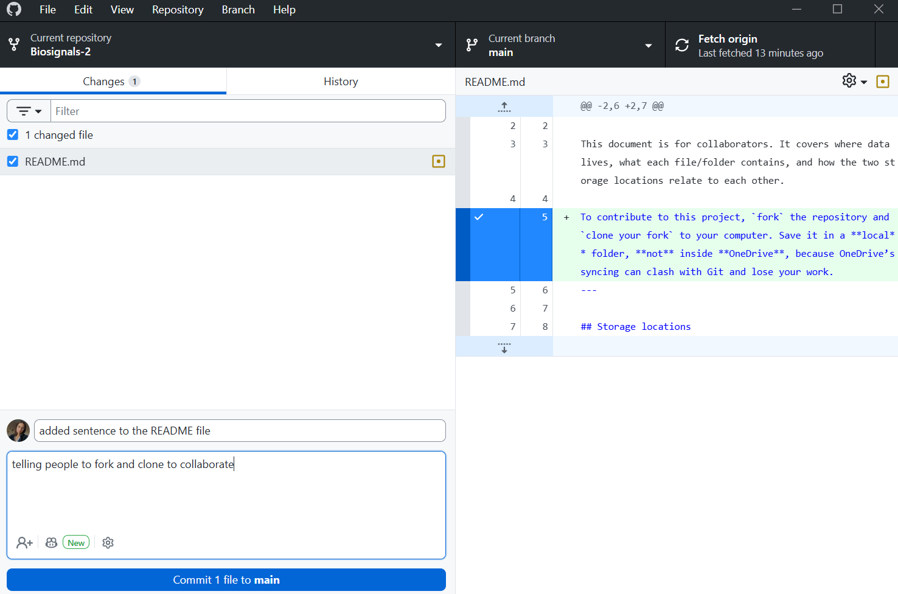{.fragment fragment-index=2}
:::

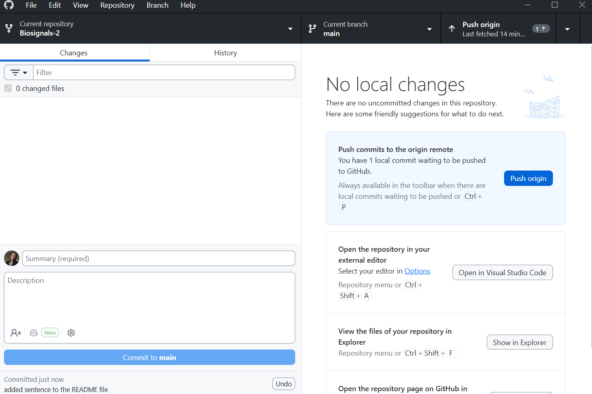{.fragment fragment-index=7}
:::
:::

::::

## Good vs bad commit messages

:::: {.columns}

::: {.column width="50%"}
::: {.card .bad}
[Bad]{.card-title}

- `update`
- `stuff`
- `asdfgh`
- `final version`
:::
:::

::: {.column width="50%"}
::: {.card .good}
[Good]{.card-title}

- `Add age to demographics table`
- `Fix typo in methods section`
- `Remove outliers above 3 SD`
- `Update figure 2 colours`
:::
:::

::::

. . .

::: {.keybox}
Future you will thank you!
:::

## 4. Push to your fork

:::: {.columns}

::: {.column width="30%"}
::: {.nonincremental}
[1. Click **Push origin**]{.fragment fragment-index=1}

[2. Refresh **your fork** on github.com: your changes are there]{.fragment fragment-index=3}
:::
:::

::: {.column width="70%"}
::: {.r-stack}
{.fragment fragment-index=2}

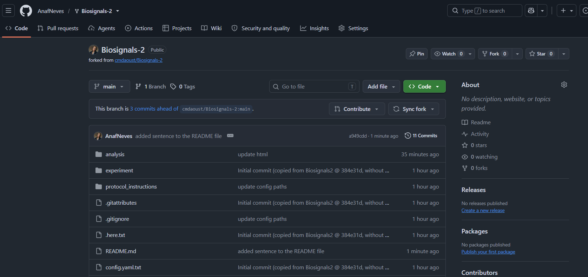{.fragment fragment-index=4}
:::
:::

::::

## 5. Open a pull request

A **pull request** (PR) asks the owner of the original repo to add your changes.

:::: {.columns}

::: {.column width="40%"}
::: {.nonincremental}
[1. On github.com, go to **your fork** ➜ **Pull requests** ➜ **New pull request**]{.fragment fragment-index=1}

[2. Check the arrow: **base** = the original ← **head** = your fork, then click **Create pull request**]{.fragment fragment-index=3}

[3. The owner reviews, comments and **merges**]{.fragment fragment-index=5}
:::
:::

::: {.column width="60%"}
::: {.r-stack}
::: {.fragment .fade-out fragment-index=4}
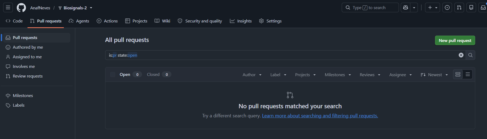{.fragment fragment-index=2}
:::

::: {.fragment .fade-out fragment-index=5}
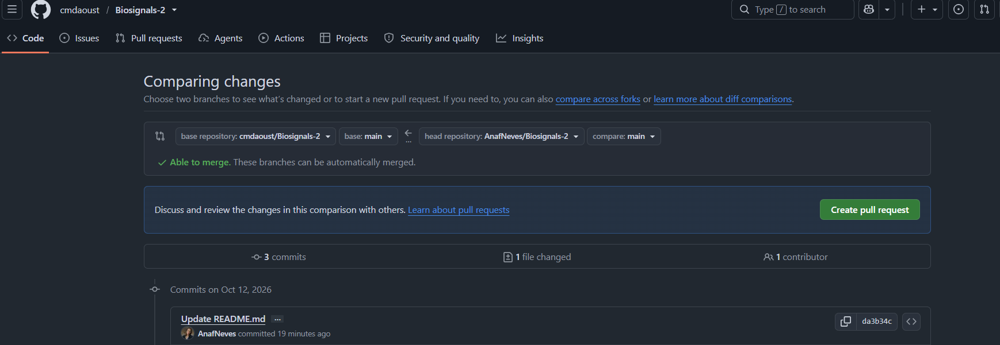{.fragment fragment-index=4}
:::

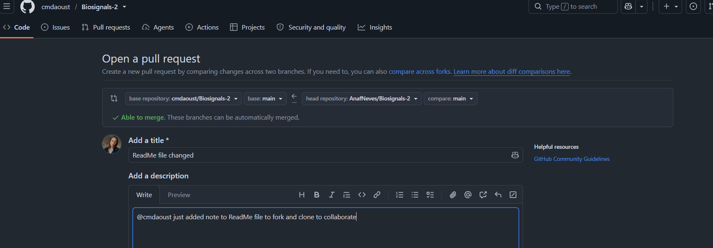{.fragment fragment-index=5}
:::
:::

::::

## 6. Keep your fork up to date

The original repo keeps changing. Before you start working:

:::: {.columns}

::: {.column width="40%"}
::: {.nonincremental}
[1. On github.com, open **your fork** and click **Sync fork ➜ Update branch**]{.fragment fragment-index=1}

[2. In GitHub Desktop, click **Fetch origin**]{.fragment fragment-index=3}

[3. If there's anything new, click **Pull origin**]{.fragment fragment-index=5}
:::
:::

::: {.column width="60%"}
::: {.r-stack}
::: {.fragment .fade-out fragment-index=4}
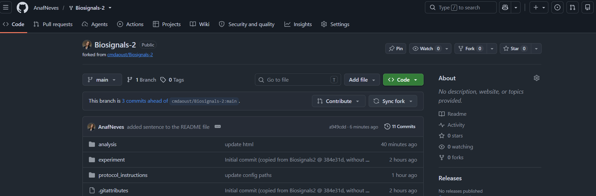{.fragment fragment-index=2}
:::

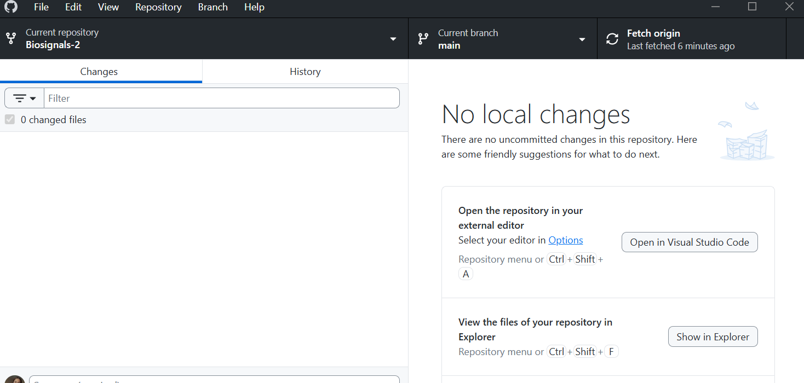{.fragment fragment-index=4}
:::
:::

::::

::: {.keybox .fragment fragment-index=7}
In GitHub Desktop, **origin** means **your fork**, not the original repo. So **Pull origin** only downloads what's already on your fork. If your fork is behind the original, there's nothing new on it to pull. **Sync fork** brings your fork up to date with the original first. Then **Pull origin** brings those changes down to your computer.
:::


## Files you shouldn't share

::: {.keybox}
Large data, outputs, passwords...
:::

- In the **Changes** tab, right-click the file
- Choose **Ignore file** (or **Ignore all .xxx files**)
- GitHub Desktop writes a `.gitignore` file for you

# Hands-on {background-color="#191970"}

## Your turn: fork a real project

::: {.nonincremental}
1. **Fork** the [Biosignals-2 repo](https://github.com/cmdaoust/Biosignals-2)
2. **Clone** your fork with GitHub Desktop
3. Have a look around: `analysis/`, `experiment/`, `protocol_instructions/`
4. Make a small change, e.g., add a sentence to `README.md`
5. **Commit** with a good message and **push** to your fork
6. Open a **pull request** to `cmdaoust/Biosignals-2`
:::

# Extras {background-color="#191970"}

## Create your own repository

On [github.com](https://github.com):

:::: {.columns}

::: {.column width="30%"}
::: {.nonincremental}
[1. Click **New**]{.fragment fragment-index=1}

[2. Give it a name]{.fragment fragment-index=3}

[3. Tick **Add a README file**]{.fragment fragment-index=5}

[4. Click **Create repository**]{.fragment fragment-index=6}
:::
:::

::: {.column width="70%"}
::: {.r-stack}
::: {.fragment .fade-out fragment-index=4}
{.fragment fragment-index=2}
:::

{.fragment fragment-index=4}
:::
:::

::::

- Then clone it, commit and push as usual: no fork needed, it's yours!

## Branch or fork? {.smaller}

| | Branch | Fork |
|---|---|---|
| **Where** | Inside the **same** repo | A **separate** copy on your account |
| **Who** | People with access to the repo | Anyone |
| **When** | Trying something in your own or your team's project | Contributing to someone else's project |

## Branches: try things safely

```{mermaid}
%%| fig-width: 10
gitGraph
  commit
  commit
  branch new-idea
  checkout new-idea
  commit
  commit
  checkout main
  merge new-idea
  commit
```

- **Current branch ➜ New branch**, then **Publish branch**
- `main` stays safe while you experiment

## Going back in time {.smaller}

| What happened | What to do in GitHub Desktop |
|---|---|
| Changed a file, **not committed** | **Changes** ➜ right-click file ➜ **Discard changes** |
| Committed, **not pushed** | **History** ➜ right-click commit ➜ **Undo commit** |
| Already **pushed** | **History** ➜ right-click commit ➜ **Revert changes in commit** ➜ **Push** |
| Just want to **look** at an old version | github.com ➜ open the file ➜ **History** |

. . .

::: {.keybox}
[Git never forgets]{.hl}: reverting adds a new snapshot that cancels the old one.
:::

## When things go wrong {.smaller}

| Problem | What to do |
|---------|-----------|
| Push is rejected | Someone else pushed first: **Pull**, then **Push** again |
| Conflict (same lines changed by two people) | GitHub Desktop shows the files: pick which version to keep, then commit |
| Committed the wrong thing | **History** ➜ right-click the commit ➜ **Revert changes in commit** |
| File too big | Don't commit it: **Ignore** it instead |

## Resources

- [GitHub Desktop documentation](https://docs.github.com/en/desktop)
- [GitHub Docs](https://docs.github.com)
- [GitHub Skills](https://skills.github.com): free interactive courses

## Questions? {.center background-color="#191970"}

{fig-align="center" width="120" style="filter: invert(1);"}

